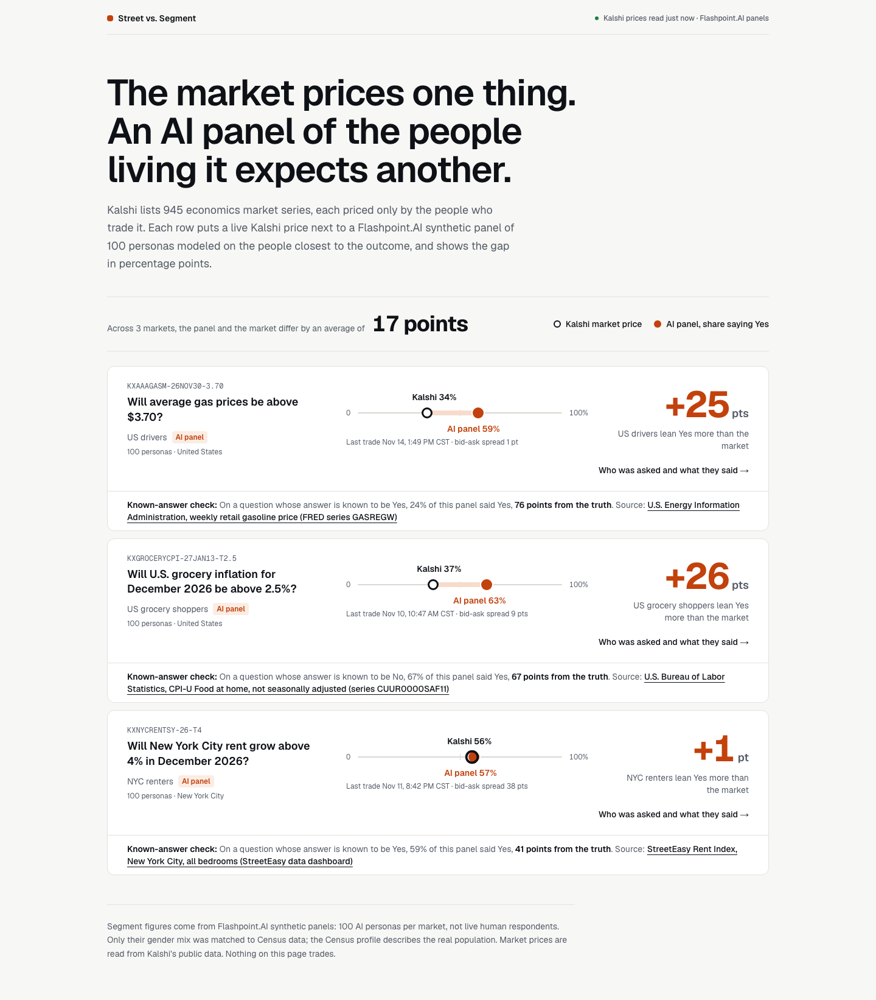
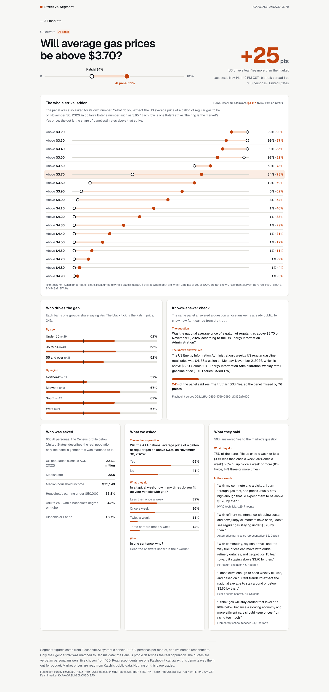
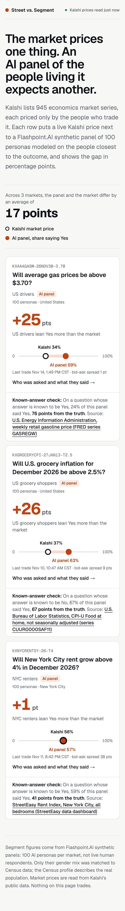
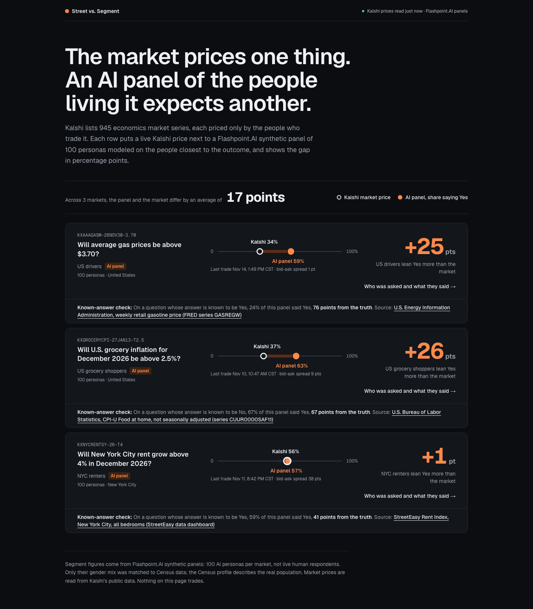

# Street vs. Segment

**Live:** https://street-vs-segment.onrender.com

Markets show what is priced in. They don't show what the people living the outcome expect. Street vs. Segment puts a live [Kalshi](https://kalshi.com) prediction-market price next to a [Flashpoint.AI](https://flashpoint.ai) panel of the people closest to the outcome, and shows the gap in percentage points.

Kalshi lists 945 economics market series (its public API, November 14, 2026), each priced only by the people who trade it. Across our first 3 markets, the panel and the market disagree by an average of 17 points.

| | |
|---|---|
|  |  |
| **Home.** Kalshi's price (ring) and the AI panel's Yes share (dot) on one scale, the gap in points, and each panel's known-answer check. | **Market page.** Who was asked, the questions, quotes, who drives the gap, and the strike ladder. |
|  |  |
| **Phone.** The same rows at 375 px. | **Dark theme.** |

Built at Hack the Unreachable (Flashpoint.AI), November 14, 2026, for the Investment Alpha track: "Find the gap between what's priced in and what key segments privately believe".

## How it works

1. **Price.** The app reads the market's Yes price and last trade from Kalshi's public API on every page load (read-only; nothing trades).
2. **Segment.** Claude picks the group whose lives decide the outcome (renters for rent, shoppers for grocery prices) and the place.
3. **Research.** Over Flashpoint's MCP server, Claude calls `demographics` for the place's Census profile, `tool_survey` to build and check a three-question survey, and `panel create_and_run` to run a 100-persona synthetic panel with that profile as context. Each run is saved in `data/runs/`, and `docs/research-runbook.md` records exactly what was asked.
4. **Gap.** Both percentages are rounded to whole points and subtracted, so the number on the card always matches the two beside it.

## Limits, as scope choices

The segment answers come from 100 Flashpoint synthetic personas per market, not live respondents. We test each panel on a question with a known answer, and it misses by 41 to 76 points, so read the gaps as leads to check, not trades. Only their gender mix is matched to Census data, Flashpoint returned no fit score, and the five quotes per market are verbatim answers chosen from 100. Flashpoint can recruit real people (Prolific, Dynata, Cint) with one call; this build leaves that out for budget. Thin Kalshi books can move a price, so each card shows the last trade time and the bid-ask spread.

## Run it

Needs Node 26 (see `.node-version`). No API keys: Kalshi's public data needs no account, and the research runs are already saved in `data/runs/`.

```bash
npm ci
npm run dev
```

The app opens on http://localhost:3000 (set `PORT` to change it).

`./check` also needs [gitleaks](https://github.com/gitleaks/gitleaks) and Playwright's Chromium (`npx playwright install chromium`). It runs the secret scan, the feature map, lint, types, unit and property tests, the build and the browser tests.
